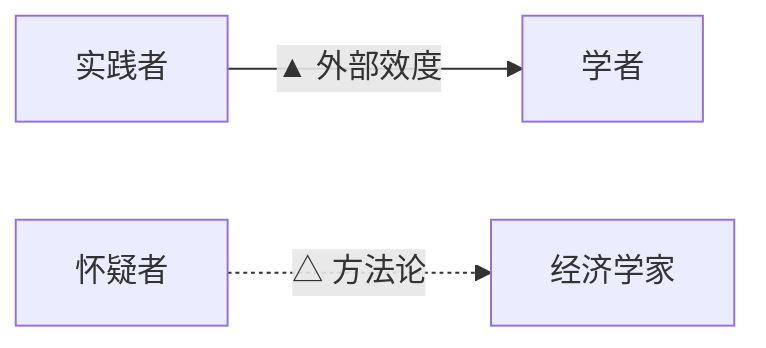

# 五视角矛盾图（Conflict Map）

`five-expert-panel` 的姊妹技能。上一步产出的是五个并列的视角；这一步把它们**叠在一起磨**，看哪两块石头真能碰出火星。

五个视角并列陈列只是素材。真正有信息量的东西全在接缝处：谁和谁真在打架、谁手里的证据经得起看、哪个问题一撬就能拆掉一大片分歧、哪些地方五个人集体沉默。

## When to Use（何时用）

- 已经有五视角输出（自己的或子代理跑的），想知道它们之间到底谁对
- 用户说“画一张矛盾图”“谁的证据最强”“哪个问题一解决就通了”“盲区在哪”
- 写深度文章需要找一个真问题做主线——keystone question 通常就是文章标题
- 做决策前想知道：这五个声音里，我该听哪个、哪些可以忽略

不适用：还没跑过五视角（先跑 `five-expert-panel`）；或者用户只想要一句结论。

## 输入契约

需要每个视角的三块内容：核心立场、最强证据、只有他会说的事。缺一块也能跑，但要在输出里标明“缺 X 视角的证据，强度评定为暂定”。

如果手上只有主题没有五视角输出：先用 `five-expert-panel` 的轻量版跑一轮（10 分钟），再回来做矛盾图。不要跳过。

## 流程

### 1. 先拆伪冲突（最重要的一步）

绝大多数“五个视角互相矛盾”是假的。检验方法：把两个视角的话各自改写成**带完整主语的命题**——谁、在什么条件下、对什么对象、断言了什么。改完再对比。

典型的四种伪冲突：

| 类型 | 长相 | 真相 |
|---|---|---|
| 外部效度分歧 | 学者说“实验室有效应”，实践者说“现场没用” | 不在同一环境，不是矛盾，是边界条件没对齐 |
| 时间尺度分歧 | 经济学家说“长期看会回归”，实践者说“下个季度就撑不住” | 两边都对，只是回答不同期限的问题 |
| 定义分歧 | 怀疑者否定的“X”和学者研究的“X”根本不是同一个东西 | 先统一定义，分歧可能直接消失 |
| 价值分歧 | 效率 vs 公平、增长 vs 稳定 | 不是事实问题。数据再多也吵不完，标注为价值分歧后**不要**再追查 |

只有拆完伪冲突剩下的那些，才值得进冲突矩阵。这一步偷懒，后面整张图都是假的。

### 2. 冲突矩阵

五行五列，只填上半三角：

- `▲` 直接冲突（同一问题上断言相反，且都给了依据）
- `△` 张力（方向不一致但不正面矛盾）
- `—` 无实质关系（不要为了对称感填东西）

### 3. 每个直接冲突写清四件事

1. 争的到底是哪个命题（一句话，可证伪）
2. 甲方依据 / 乙方依据（各自把最强的摆上来，不要抽弱对手）
3. 冲突类型：事实 / 外部效度 / 定义 / 价值
4. 可证伪路径：什么样的证据能一锤定音，谁能拿到

如果写完发现某一方拿不出依据，那不是冲突，那是**一方没证据**——直接进第 4 步。

### 4. 证据强度：必须排名，不许和稀泥

用户要的是“谁最强谁最弱”，不是“各有各的道理”。给排序时按下面五个维度加权，并在输出里说明你重了什么、轻了什么：

| 维度 | 看什么 | 为何重要 |
|---|---|---|
| 可核查性 | 能不能被第三方按图索骥复核 | 不可核查的断言只能当线索，不能当依据 |
| 证据层级 | 元分析/RCT > 大样本观察 > 单案例 > 轶事 > 推断 | 单个动人案例能击穿叙事，但撑不起结论 |
| 效应量与精度 | 0.1 和 0.8 是两个世界 | 显著性不是重要性，很多“有研究表明”说的是 0.1 |
| 独立性 | 出证据的人是否从结论中获利 | 利益相关方的数据要降权，但**不是**直接判假 |
| 反证存活 | 这个证据被同行攻击过而没有倒吗 | 没被打过的证据可能是没人屑于打 |

排名常见但反直觉的三个结果，不要回避：

- **实践者常常证据最弱**。他的“独家”往往是真的，但形式是个人经验，样本=1，无法外推。他的价值在于**提出正确的问题**，不在于给出答案。
- **历史学家的类比几乎总在最弱档**。历史相似是修辞不是证据：结构类比能提示风险，但不能预测结局，因为它无法证明“关键变量相同”。
- **怀疑者如果只有否定，也是最弱的一档**。反证只有在给出替代解释时才有解释力；只想推翻不想解释，本质上和它反对的对象一样弱。

同时必须指出**最强的那一个**，并说清是“强在哪一维度”：是层级高，还是效应量大，还是它恰好是唯一可核查的。

### 5. Keystone Question（撬动性问题）

在所有冲突里挑**一个**问题，回答它就能连带消解最多的对立。

筛选标准（三个必须同时满足）：

1. **覆盖面**：它的答案会让至少两对冲突重新排列，而不只是一对
2. **可回答**：有具体的研究设计、数据源或实验能给出答案（不是“取决于价值观”）
3. **成本可控**：回答它的代价（时间/数据获取/伦理）在现实范围内

排序公式：`化解的冲突数量 × 冲突严重度 ÷ 回答成本`。算出来最靠前的那个就是。

写 Keystone 时给四块：

- 问题本身（一句问句，具体到能被研究）
- 它一旦有答案，哪几个视角必须改口，怎么改
- 怎么回答它（数据/实验/田野，谁手里有）
- **现在能猜的答案区间**（即使没数据也要给区间，让用户知道该期待什么量级）

如果找不到满足三个条件的问题，诚实说“当前没有能一锤定音的问题，需要先解决测量问题”，不要硬凑一个。

### 6. 共识：大概率真，但别当免检章

五个视角一致同意的，大概率是可靠的——不同利益、不同方法论的人同时得出同一结论，这个交叉验证有真实分量。

但必须补一刀：**共识也可能是共享同一个错误前提**。五个都在同一个范式里，就会集体看不见范式本身的问题。所以共识要标两类：

- 强共识：来自不同方法论、不同利益方的独立印证 → 可以当结论用
- 弱共识：所有人用的是同一批数据/同一个口径/同一个未被检验的前提 → 只是“大家都这么以为”

### 7. 沉默：盲区分三种，处理方式完全不同

| 类型 | 为什么没人提 | 怎么识别 | 怎么处置 |
|---|---|---|---|
| 结构性盲区 | 学科分工导致没人负责这一块 | 五个视角的专业训练都不覆盖它 | 最值得写，往往是领域真空白 |
| 利益性沉默 | 提了有代价（丢客户、丢帽子、丢项目） | 有人显然知道却集体不提，或仅以私人语气出现 | 谨慎处理，需匿名源或一手文件 |
| 时间性盲区 | 太新，数据还没长出来 | 现象出现不足 1–2 个周期 | 标注“数据未成熟”，不要下结论 |

把三种分开写，不要混成一句“信息不足”。结构性盲区是这套方法最大的产出，值得单独一段。

## 输出模板

```markdown
# 矛盾图：<收窄后的主题>

## 0. 五方底牌
| 视角 | 一句话立场 | 手上最硬的牌 |
|---|---|---|

## 1. 冲突矩阵
（5×5 三角矩阵，▲ / △ / —）

## 2. 直接冲突明细
### C1 <视角A> vs <视角B>：<争的命题>
- A 依据：……
- B 依据：……
- 类型：事实 / 外部效度 / 定义 / 价值
- 可证伪路径：……
（C2、C3……）

## 3. 证据强度排行
| 排名 | 视角 | 最强证据 | 证据层级 | 可核查 | 独立性 | 软肋 |
|---|---|---|---|---|---|---|

**最强为什么最强**：……
**最弱为什么最弱**：……

## 4. Keystone Question
> <一句可研究的问句>

- 撬动效果：有答案后 <A> 和 <B> 必须改口，<C> 的立场从 X 变 Y
- 怎么回答：<数据/实验/田野，成本>
- 现在能猜的区间：……

## 5. 全场共识
- 强共识（可当结论）：……
- 弱共识（可能是共享前提）：……

## 6. 无人提及
- 结构性盲区：……
- 利益性沉默：……
- 时间性盲区：……
```

可选：把冲突矩阵渲染成 mermaid 便于放进文章。



## 质量红线

- **不许和稀泥**。“各有各的道理、需要综合看待”是失败的输出。用户要的是排序和一个真问题。
- **不许把伪冲突当真冲突**。没拆完定义和前提就进矩阵，整张图都是废的。
- **不许靠抽弱对手制造冲突**。每个视角必须拿最强论点上场，赢了才算赢。
- **不许把价值分歧当事实分歧去“查证”**。标注清楚后停下，别用数据假装能解决它。
- **不许为了填满表格编证据**。证据强度表里如果某个视角拿不出可核查证据，写“无可核查证据”并把排名放末位，这本身就是重要发现。
- **Keystone 不许给不可回答的问题**（“社会应该怎么选”）。给不了就诚实说没有。

## 与其他技能的分工

- 上游：`five-expert-panel`（产出五视角素材）
- 本技能：把素材变成结构化的冲突、排序和关键问题
- 下游：`five-expert-brief`（把五视角 + 矛盾图压成一页可执行的调研简报；矛盾图的证据排序直接决定简报里五条发现怎么排）
- 侧路：`deep-research-pro`（把 Keystone Question 变成真实调研）、写作类技能（用 Keystone 当文章主线）
